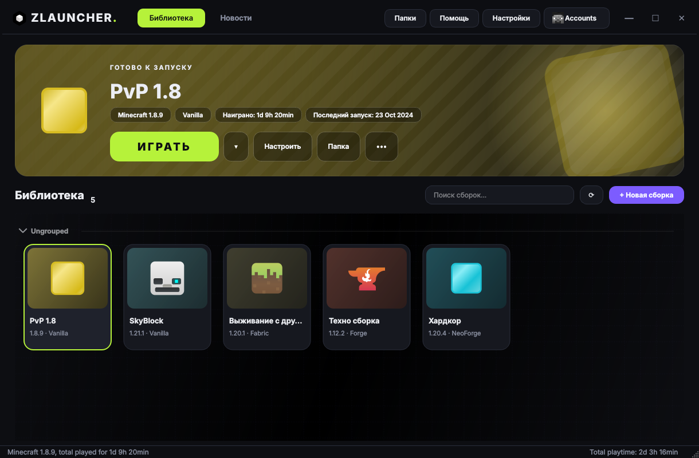
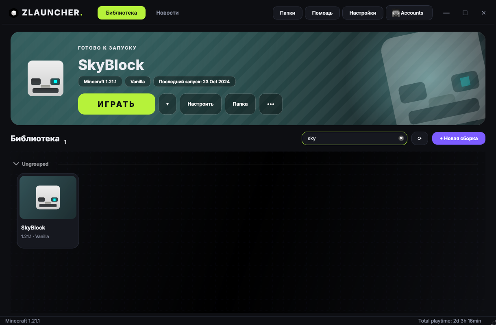
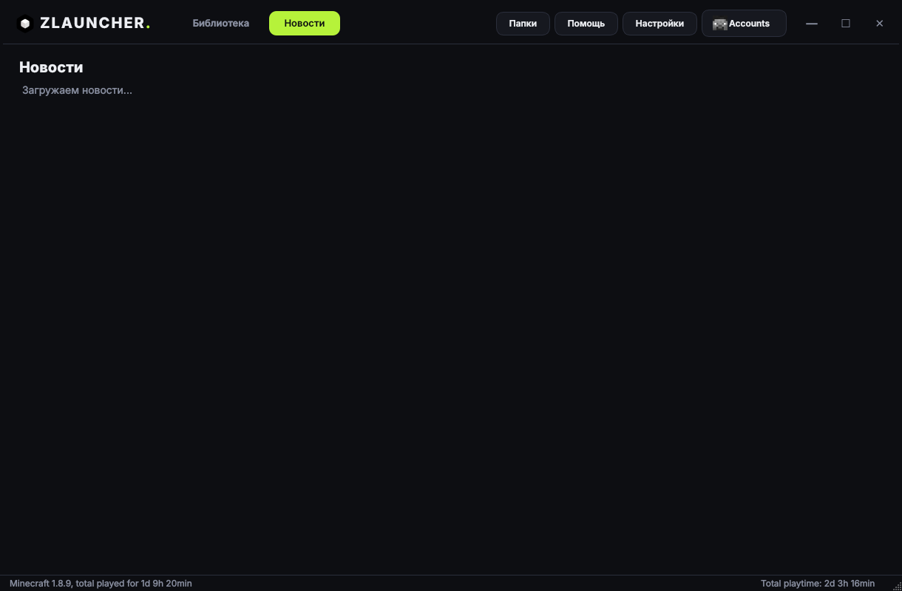

# Zlauncher

<p align="center">
  
</p>

<h3 align="center">Лаунчер Minecraft с новым интерфейсом и офлайн-режимом</h3>

<p align="center">
  <a href="https://github.com/cfif300a/Zlauncher/releases"><b>Скачать</b></a>
  ·
  <a href="#-сборка-из-исходников"><b>Сборка</b></a>
  ·
  <a href="#-лицензия"><b>Лицензия</b></a>
</p>

Zlauncher — форк [Prism Launcher](https://prismlauncher.org/) с переработанным главным окном. Вся логика запуска, загрузки версий, модов и Java осталась от Prism, а то, что видно на экране, сделано заново.

<p align="center">
  
</p>

## ✨ Что изменилось

- **Своя шапка окна.** Окно без системной рамки: логотип, вкладки «Библиотека» и «Новости», быстрые кнопки «Папки», «Помощь», «Настройки» и аккаунт. Перетаскивание за шапку, двойной клик разворачивает окно.
- **Баннер выбранной сборки.** Сверху крупно показана выбранная сборка: иконка, версия Minecraft, загрузчик, сколько времени в ней провёл и когда последний раз запускал. Цвет баннера берётся из иконки сборки.
- **Большая кнопка «ИГРАТЬ».** Пока сборка запущена, кнопка превращается в «СТОП». Рядом «Настроить», «Папка» и меню с остальными действиями: переименование, смена иконки, группа, копирование, экспорт, ярлык и удаление.
- **Карточки сборок.** Каждая сборка — карточка с иконкой, версией и загрузчиком (Fabric, Forge, NeoForge, Quilt, Vanilla). На карточке видно статус: «В ИГРЕ», «СЛОМАНА» или «ОБНОВЛЕНИЕ».
- **Поиск.** Строка над сеткой фильтрует сборки по названию прямо на ходу.
- **Новости в окне.** Вкладка «Новости» открывается внутри лаунчера, ссылки открываются в браузере.
- **Тёмная палитра.** Фон почти чёрный, акценты салатовый и фиолетовый. Палитра шапки и карточек фиксированная и не зависит от выбранной темы.

<p align="center">
  
</p>

<p align="center">
  
</p>

## 🚀 Возможности

- 🔑 **Офлайн-режим:** играть можно без авторизации через Microsoft.
- 📦 **Сборки и загрузчики:** Vanilla, Fabric, Forge, NeoForge, Quilt и другие, как в Prism Launcher.
- 🧩 **Моды, ресурспаки, шейдеры и миры:** управление из карточки сборки.
- 🎨 **Темы оформления:** Amber, Violet, Ocean, Emerald, Dark, Bright и Fusion для системных окон и диалогов.
- ☕ **Java:** автоопределение и автозагрузка Java.

## 📦 Скачать

Готовый архив — в разделе [**Releases**](https://github.com/cfif300a/Zlauncher/releases).

## 🛠 Сборка из исходников

Нужны CMake 3.25+, компилятор с поддержкой C++20 и Qt 6.4 или новее (модули Core, Widgets, Network, NetworkAuth, Concurrent, Xml, OpenGL, Svg, 5Compat).

```bash
git clone --recursive https://github.com/cfif300a/Zlauncher.git
cd Zlauncher
cmake -S . -B build -G Ninja -DCMAKE_BUILD_TYPE=Release
cmake --build build
```

Если клонировал без `--recursive`, подтяни сабмодули: `git submodule update --init`.

## 🤝 Благодарности

Zlauncher держится на работе команды [Prism Launcher](https://github.com/PrismLauncher/PrismLauncher) и её участников. Логика запуска, загрузки и работы с модами взята у них.

## 📄 Лицензия

Проект распространяется по [GNU GPL v3](LICENSE), как и Prism Launcher.
